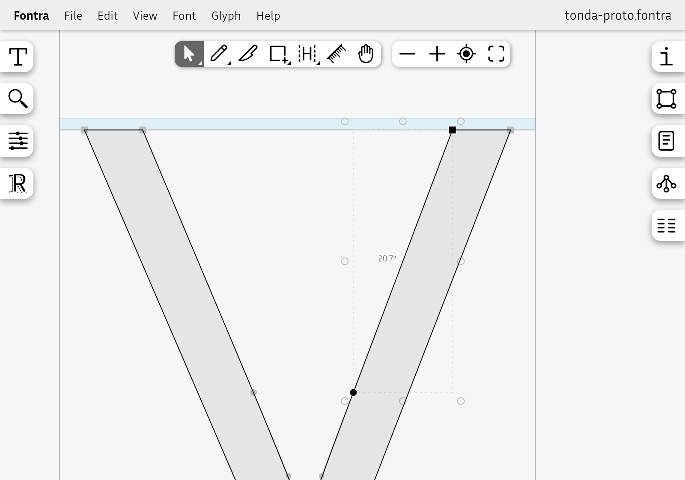

# fontra-angle

A [Fontra](https://fontra.xyz) plugin that shows the angle between two selected points.



Select exactly two points in the glyph editor and a small label beside the line between them shows the angle from the **vertical** — the same value you would type in a component's skew. Any other selection shows nothing.

## Usage

1. Open a glyph in the glyph editor.
2. Select two points — click one, then <kbd>Shift</kbd>-click the other. On-curve and off-curve points both work, so you can measure a stroke edge or a handle.
3. Read the angle next to the segment. The label is redrawn with the canvas, so it follows the points when you move the selection, pan or zoom.

Select a third point, or deselect one, and the label disappears.

## How it works

| Part | What it does |
|---|---|
| `plugin.json` | Tells Fontra to load `start.js` and call its `start` function. |
| `start.js` | Registers a visualization layer in the glyph editor and turns it on. |

On every redraw the layer looks at the current selection of the glyph being edited and keeps only the points (`point/<index>`). If there are exactly two, it reads their coordinates and computes:

```
angle = atan2(|dx|, |dy|)
```

- **0°** is a vertical line, **90°** a horizontal one.
- Using absolute values makes the result independent of the order you selected the points and of the line's direction, so it is always between 0° and 90°.
- The value is rounded to one decimal place.

The label sits at the midpoint of the segment, pushed 8 px to the side along the perpendicular so it never covers the line. It is drawn in screen pixels — the same size at any zoom — with a thin halo in the canvas color to stay legible over outlines, and it follows Fontra's light and dark themes.

The plugin only draws; it never changes the font.

## Install

In Fontra, open **Settings → Plugins**, click **+** and enter the address of the version you want:

```
https://cdn.jsdelivr.net/gh/Gustavo-Tondin/fontra-angle@1.1.0
```

Reload the editor. Each release has its own address, so the browser never keeps a stale copy; to update, remove the old entry and add the new version.

## License

MIT
